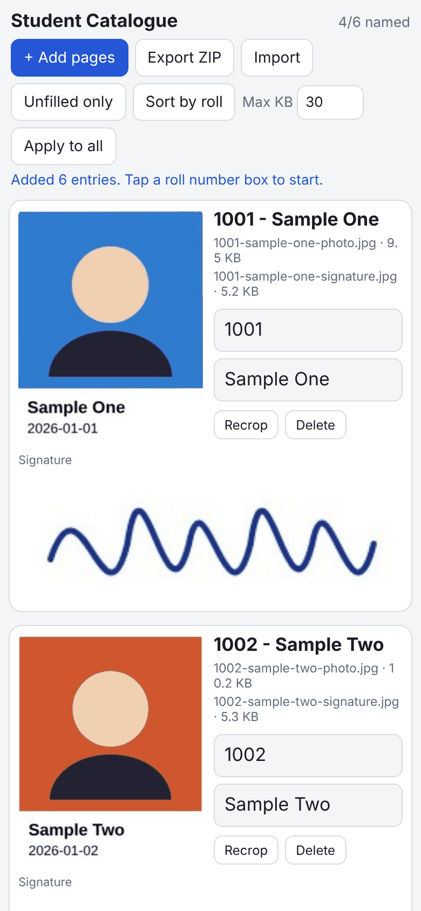
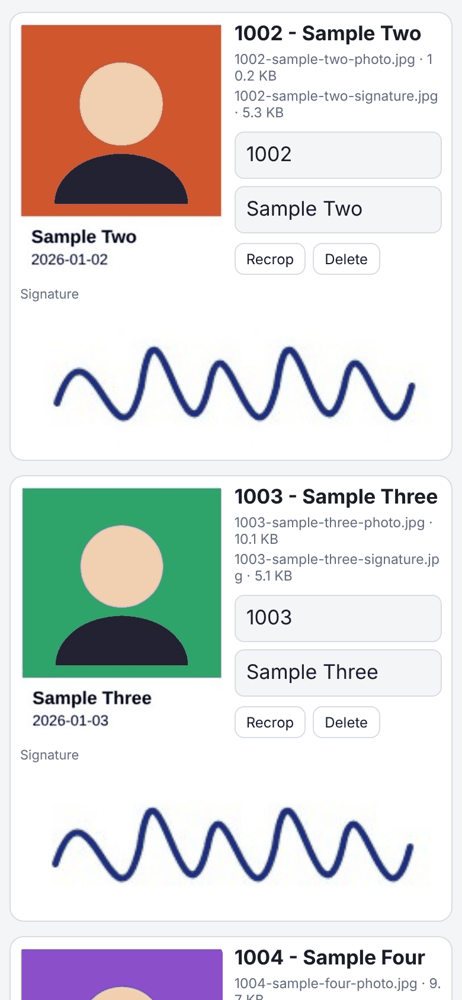
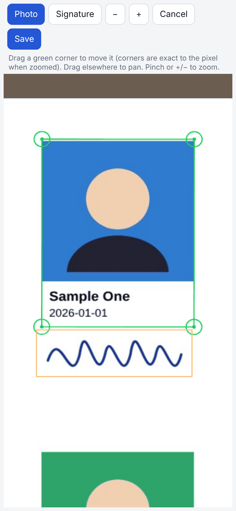

# Student Catalogue

> School teachers can turn phone photos of student sheets into correctly named, size-capped photo and signature files without cropping, renaming and compressing each one by hand.

**Try it:** [dvynsh3.github.io/Student-Catalogue](https://dvynsh3.github.io/Student-Catalogue/)  ·  **Status:** Active, in use; no new features planned  ·  **Platform:** Browser, built for Chrome on Android

The screenshots use a generated dummy sheet with invented names. No real student data appears anywhere in this repository.

## Why this exists
- **Who:** School teachers who keep student photos and signatures on sheets in a standard physical format prescribed by their school, and who must upload them to government-mandated portals.
- **Before:** Each page was photographed, then every photo and signature was cropped by hand, renamed to the required convention, stored in one place and reviewed. Results often missed the portal's size limit, so files were run through online compression tools, which raised privacy concerns for student images.
- **Now:** Photograph the sheets, type each roll number and name once, and export a ZIP of correctly named files under the size limit, with nothing uploaded anywhere. By the author's estimate this saves more than an hour per batch.

## What it does
**Capture**
- Reads several page photos at once and turns each page upright, including landscape and upside-down shots.
- Finds each student's photo and signature on the page and crops them, correcting the sticker's perspective.

**Name**
- Moves from roll number to name to the next card with the Next key, so a page is typed without touching the screen.
- Names files `rollnumber-name-photo.jpg` and `rollnumber-name-signature.jpg` as you type.

**Check and fix**
- Shows large previews with the real file name and size, and outlines duplicate roll numbers in red.
- Filters to unfilled entries and sorts by roll number.
- Recrops by hand with zoom, draggable photo corners and a signature box when detection is off.

**Hand over**
- Caps every image at a size you set (default 30 KB, range 5 to 500 KB, because portals differ) and applies it to existing crops on request.
- Exports a ZIP with `photos/`, `signatures/`, `catalogue.csv` and `catalogue.json`, and imports one back as a backup.

  
  

## Quick start
1. Open the live page in Chrome, or download [`index.html`](index.html) and open it from your device.
2. Tap **+ Add pages** and select your page photos. Cards appear with the photo and signature cropped.
3. Type the roll number, press Next, type the name, press Next. Repeat down the list.
4. Tap **Recrop** on any card where the crop is off, adjust, then **Save**.
5. Tap **Export ZIP**. You get `student-catalogue.zip` with the named image files and a CSV index.

## Decisions and trade-offs
| Decision | Over | Because |
|---|---|---|
| Crop and compress on the device | Online compression tools | Student images never leave the device |
| Very few buttons | A full editor with many options | Teachers sat with the author and asked for something usable without guidance next time |
| Typed roll numbers and names | OCR | The text is handwritten and OCR is unreliable on it; a teacher who knows the students types faster |
| Configurable size cap | A fixed 30 KB | 30 KB is typical, but the limit changes from portal to portal |
| Local autosave, no server | Cloud sync | Privacy, and the job is done once a year with photos usually revised, so syncing old data has no value |

**What I left out on purpose**
- OCR, for the reason above.
- Cloud sync and accounts, for the reasons above.

Technical notes

One HTML file with no libraries or build step. Detection and cropping use the browser canvas. Work autosaves to IndexedDB. ZIP export and import use a hand-written CRC-32, store-mode reader and writer.

## Known limits
- Detection is heuristic. Plain, well-lit, flat pages on a light background work best.
- The detector looks for blue ink. For other colours, such as black, it falls back to a default box under the photo. Black ink has worked in use; use **Recrop** if the box is off.
- Roll numbers accept digits only, and leading zeros are removed.
- Autosave lives in browser storage, which can be cleared. Export regularly.
- Opened as a local file, Android may keep storage separate for each app used to open it. The hosted page gives one stable address.
- Exported ZIPs do not contain the original page photos, and entries restored from a ZIP cannot be recropped.
- An entry with no name exports with `noname` in its file name.

## Privacy and data
- Everything runs on your device. The code makes no network requests, loads no external scripts and has no analytics.
- Page photos, crops and typed names are stored in your browser's local storage so work survives a reload. The size cap is stored the same way.
- Files leave the device only when you export a ZIP.
- Opening the hosted page fetches the app from GitHub Pages, which keeps its own server logs. The app sends nothing back.
- Sheets of student photos and signatures are personal data. Export, then clear the site's storage in your browser when a batch is done.
- Works fully offline when `index.html` is saved to the device. The hosted page needs a connection to open, because there is no offline cache.

## Evidence
Used by the author to submit data for more than 200 students across 2 or more school portals. This is the author's own account, not independently measured. [TBD: month of use]

## Version history
Latest: **v0.4.0** ([TBD: YYYY-MM-DD]). There is no changelog and no further updates are planned.

| Version | Date | What changed for the user |
|---|---|---|
| v0.4.0 | [TBD] | First and only version published here: the finished tool after feedback from teachers was built in. |

Only v0.4.0 is published. Earlier builds were kept as local backups and uploaded in one go, so the commit history is a snapshot of the final version, not the development history.

## Feedback
Report problems in [Issues](../../issues). Useful to include: the phone and browser, how the page was photographed (light, angle, paper), what you expected, and what happened. Do not attach real student photos; use a dummy sheet. No further updates are planned, so replies are not guaranteed.

## How this was built
I own the problem, the scope, the trade-offs and the testing. I specified and directed the work, and Claude wrote much of the implementation. I tested it on actual student sheets and reworked it live with teachers, then shipped it.

## Credits
Built solo. No third-party libraries, reference tools or websites were used beyond Claude.

## Licence
[MIT](LICENSE). Copyright (c) 2026 dvynsh3.
